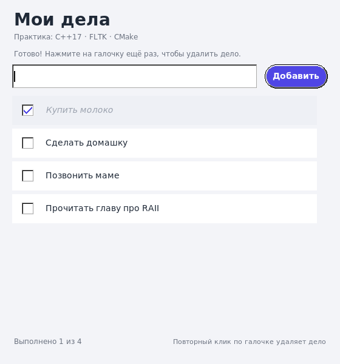
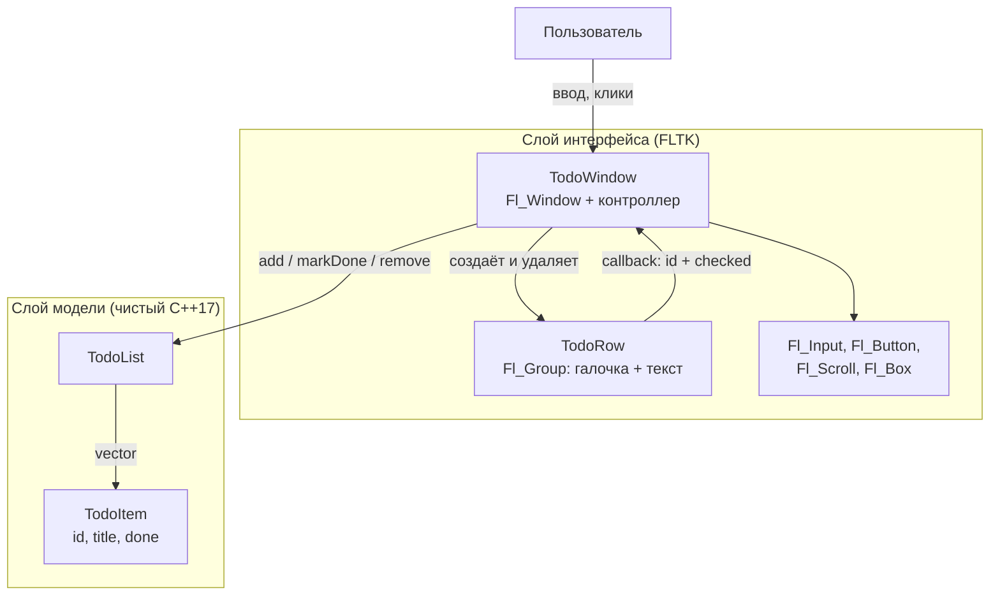
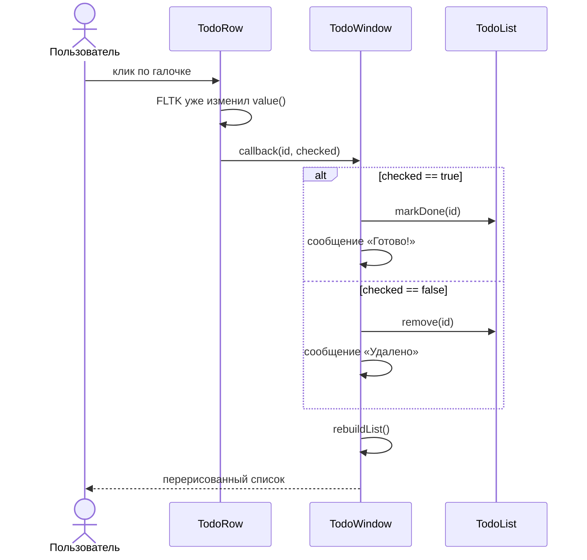

# TODO-лист на C++17 и FLTK

Учебное мини-приложение: список дел с галочками. Проект специально написан
небольшими, понятными файлами, чтобы на паре можно было обсудить C++17,
FLTK, CMake, RAII и обработку ошибок.



## Что умеет приложение

- Добавлять дело кнопкой «Добавить» или клавишей Enter.
- Показывать список дел с квадратной галочкой слева.
- Первый клик по галочке отмечает дело выполненным (текст становится серым
  и курсивным).
- Повторный клик по уже установленной галочке удаляет выполненное дело.
- Показывать счётчик «Выполнено N из M».
- Показывать понятное сообщение при пустом вводе, а не падать.
- Прокручивать длинный список.

> **Почему удаление происходит по галочке?** Это требование учебного задания:
> первый клик = «сделано», второй клик = «убрать из списка». Подсказка об этом
> всегда видна внизу окна. В реальном приложении чаще делают отдельную кнопку
> удаления — этот вариант предложен в домашнем задании в `LESSON.md`.

## Стек и зависимости

| Компонент | Версия | Зачем нужен |
|---|---|---|
| C++ | 17 | `std::string`, `std::vector`, `std::function`, `std::unique_ptr` |
| FLTK | 1.3+ | окно, кнопки, чекбоксы, прокрутка |
| CMake | 3.16+ | сборка приложения и тестов |

В Ubuntu/Debian всё ставится из `apt`:

```bash
sudo apt update
sudo apt install -y build-essential cmake libfltk1.3-dev
```

Проверить установку:

```bash
cmake --version
fltk-config --version
dpkg -l | grep libfltk1.3-dev
```

FLTK подключается в CMake через стандартный модуль `FindFLTK.cmake`, который
использует установленный `fltk-config`. Никакие библиотеки не копируются в
репозиторий и не собираются вручную.

## Сборка и запуск

```bash
# из корня проекта
cmake -S . -B build -DCMAKE_BUILD_TYPE=Release
cmake --build build -j"$(nproc)"
./build/todo
```

Если нужно пересобрать с нуля:

```bash
rm -rf build
cmake -S . -B build
cmake --build build
```

## Тесты

```bash
(cd build && ctest --output-on-failure)
```

Эту же команду можно записать как `ctest --test-dir build --output-on-failure`,
если у вас CMake 3.20 или новее.

В проекте две проверки:

1. **`todo_model`** — тесты модели `TodoList` без графики. Работают всегда,
   в том числе на сервере без экрана.
2. **`todo_ui`** — интеграционный тест окна: создаёт настоящее окно FLTK,
   нажимает кнопку и галочки, проверяет состояние списка и прокрутку.
   Для него нужен `DISPLAY`. Если графического окружения нет, тест
   возвращает код 77, и CTest помечает его как `Skipped`, а не `Failed`.

Ожидаемый результат:

```text
100% tests passed, 0 tests failed out of 2
```

### Сборка с санитайзерами (по желанию)

```bash
cmake -S . -B build-asan -DCMAKE_BUILD_TYPE=Debug \
  -DCMAKE_CXX_FLAGS="-fsanitize=address,undefined -fno-omit-frame-pointer" \
  -DCMAKE_EXE_LINKER_FLAGS="-fsanitize=address,undefined"
cmake --build build-asan -j"$(nproc)"

# LeakSanitizer может ругаться на внутренние кэши fontconfig.
# Для проверки именно нашего кода отключаем поиск утечек:
(cd build-asan && ASAN_OPTIONS=detect_leaks=0 ctest --output-on-failure)
```

## Как пользоваться

1. Введите текст в поле сверху.
2. Нажмите «Добавить» или Enter — дело появится в списке.
3. Нажмите на пустую галочку — дело станет выполненным.
4. Нажмите на ту же галочку ещё раз — выполненное дело исчезнет.
5. Кнопка и поле работают и после ошибки: например, пустой ввод показывает
   сообщение, но приложение продолжает работать.

Окно имеет фиксированный размер `560×600`. Это осознанное упрощение: вся
вёрстка задана координатами, и не нужно писать отдельный код перерасчёта
при изменении размера.

## Структура проекта

```text
fltk_todo/
├── CMakeLists.txt          # цели сборки, FLTK, тесты
├── README.md               # этот файл
├── LESSON.md               # сценарий занятия для преподавателя
├── .gitignore
├── docs/
│   └── screenshot.png      # как выглядит приложение
├── include/
│   ├── TodoItem.h          # структура одного дела
│   ├── TodoList.h          # модель: добавление, отметка, удаление
│   ├── TodoRow.h           # виджет одной строки списка
│   ├── TodoWindow.h        # главное окно и действия пользователя
│   └── Theme.h             # единая палитра цветов
├── src/
│   ├── TodoList.cpp
│   ├── TodoRow.cpp
│   ├── TodoWindow.cpp
│   └── main.cpp            # точка входа, RAII и try/catch
└── tests/
    ├── test_todo_list.cpp  # тесты модели без FLTK
    └── test_todo_ui.cpp    # тест настоящих кликов по виджетам
```

### Карта ответственности

| Файл | Отвечает за | Не знает про |
|---|---|---|
| `TodoItem.h` | данные одного дела | FLTK, список |
| `TodoList` | правила работы со списком, проверки, id | кнопки и окна |
| `TodoRow` | внешний вид строки и сигнал «по галочке щёлкнули» | весь список |
| `TodoWindow` | вёрстку, события, связь модели и виджетов | детали хранения дел |
| `main.cpp` | запуск и завершение приложения | бизнес-логику |

## Архитектура

Приложение разделено на три слоя. Стрелки показывают направление зависимостей:
модель не зависит от интерфейса, а интерфейс зависит от модели.



Та же схема в текстовом виде — удобно рисовать на доске:

```text
                    событие FLTK
 Пользователь ────────────────────────┐
                                      ▼
                         ┌─────────────────────────┐
                         │ TodoWindow              │
                         │ (Fl_Window, контроллер) │
                         └───────┬─────────┬───────┘
              создаёт строки     │         │  вызывает методы
                                 ▼         ▼
                         ┌───────────┐  ┌─────────────────┐
                         │ TodoRow   │  │ TodoList        │
                         │ [✓] текст │  │ vector<TodoItem>│
                         └─────┬─────┘  └─────────────────┘
                               │ callback(id, checked)
                               └──────────────▶ TodoWindow
```

### Диаграмма классов

```mermaid
classDiagram
    class TodoItem {
        +ItemId id
        +string title
        +bool done
    }

    class TodoList {
        -vector~TodoItem~ items_
        -ItemId nextId_
        +add(title)
        +markDone(id)
        +remove(id)
        +items()
        +size()
        +doneCount()
    }

    class TodoWindow {
        -TodoList model_
        -Fl_Input* input_
        -Fl_Button* addButton_
        -Fl_Scroll* scroll_
        +addTask(title)
        +toggleTask(id, checked)
        +taskCount() size_t
        +doneCount() size_t
    }

    class TodoRow {
        -ItemId id_
        -Fl_Check_Button* check_
        +onToggle(handler)
    }

    TodoWindow "1" *-- "1" TodoList : владеет
    TodoWindow "1" o-- "0..*" TodoRow : создаёт и пересоздаёт
    TodoRow ..> TodoWindow : std::function callback
    TodoList "1" *-- "0..*" TodoItem
```

### Последовательность обработки клика



## Как устроен код

### 1. Модель: `TodoItem` и `TodoList`

`TodoItem` — простая структура без поведения:

```cpp
struct TodoItem {
    ItemId id = 0;
    std::string title;
    bool done = false;
};
```

`TodoList` хранит `std::vector<TodoItem>` и отвечает за инварианты:

- название обрезается по краям и не может быть пустым;
- у каждого дела есть уникальный `ItemId`;
- удалённый id не выдаётся повторно;
- `markDone()` идемпотентен (повторная отметка не ломает состояние);
- ошибки сообщаются исключениями `std::invalid_argument` и
  `std::out_of_range`.

Модель ничего не знает о FLTK. Поэтому её тесты запускаются без экрана и
работают за доли секунды.

### 2. Строка списка: `TodoRow`

`TodoRow` — наследник `Fl_Group`, внутри которого живут:

- `Fl_Check_Button` — квадратная галочка;
- `Fl_Box` — текст дела.

В конструкторе вызываются `begin()` и `end()`: это стандартный способ сказать
FLTK, что создаваемые виджеты должны стать детьми данной группы.

Строка не удаляет дело сама. Она вызывает переданный обработчик:

```cpp
using ToggleHandler = std::function<void(ItemId id, bool checked)>;
```

Почему `std::function`, а не сырой указатель на функцию? Так окно может передать
лямбду, которая захватывает `this` и вызывает нужный метод. Код остаётся
коротким и типобезопасным.

Важная деталь FLTK: к моменту вызова callback значение чекбокса **уже
изменено**. Поэтому `checked == true` означает «галочку только что поставили»,
а `checked == false` — «галочку только что сняли» (в нашем UX это удаление).

Ещё одна деталь: `label()` в FLTK сохраняет **указатель** на строку, а не её
копию. Локальная строка умерла бы после конструктора, поэтому используется
`copy_label()` и `copy_tooltip()`. Это одна из самых частых причин «мусора» в
интерфейсе и падений.

### 3. Окно-контроллер: `TodoWindow`

`TodoWindow`:

- создаёт все статические виджеты в `buildUi()`;
- принимает события от кнопки, поля ввода и строк;
- вызывает методы модели;
- полностью пересоздаёт строки в `rebuildList()` после каждого изменения.

Полная перестройка выбрана специально: для списка из десятков дел это
достаточно быстро, зато не нужно поддерживать соответствие «индекс строки —
индекс в векторе» и проще объяснить поток данных.

При перестройке старые строки удаляются через `Fl::delete_widget()`. Это
безопасное отложенное удаление: перестройка может быть вызвана из callback
самой галочки, и обычный `delete` уничтожил бы виджет, который ещё находится
на стеке обработки события FLTK.

Прокрутка вниз считается вручную: `Fl_Scroll::scroll_to()` не ограничивает
аргумент, поэтому передавать туда `INT_MAX` нельзя — дети списка уедут за
пределы координат. В коде сначала вычисляется `maxScroll`, а затем уже
вызывается `scroll_to()`.

### 4. Точка входа: `main.cpp`

```cpp
auto window = std::make_unique<todo::TodoWindow>();
window->show(argc, argv);
return Fl::run();
```

`std::unique_ptr` — пример RAII: окно автоматически уничтожится при выходе из
`main`. Исключения, возникшие при создании интерфейса, перехватываются и
печатаются в `stderr`, а не приводят к необработанному падению.

## Владение памятью и RAII

| Ресурс | Кто владеет | Как освобождается |
|---|---|---|
| `std::vector<TodoItem>` | `TodoList` | автоматически, деструктор вектора |
| `std::string title` | `TodoItem` | автоматически |
| `TodoWindow` | `std::unique_ptr` в `main` | автоматически |
| Статические виджеты | окно FLTK (родитель) | деструктор `Fl_Window` |
| Строки `TodoRow` | `Fl_Scroll` (родитель) | `Fl::delete_widget()` при перестройке |
| Текст `copy_label` | сам виджет FLTK | деструктор виджета |

В коде нет ручных `new`/`delete` для окна и модели. Единственные `new` —
создание виджетов FLTK, потому что так устроен API библиотеки: родитель
забирает их в своё дерево и удаляет вместе с собой.

## Обработка ошибок

1. **Модель проверяет данные.** Пустое название — `std::invalid_argument`,
   отсутствующий id — `std::out_of_range`.
2. **Контроллер перехватывает `std::exception`.** Пользователь видит сообщение
   в интерфейсе, введённый текст не теряется, приложение продолжает работу.
3. **Исключительная безопасность.** В `TodoList::add()` счётчик id
   увеличивается только после успешного `push_back`, поэтому при нехватке
   памяти список и генератор id остаются согласованными.
4. **FLTK-ошибки не бросают исключения.** Поэтому важно самим следить за
   временем жизни виджетов и строк — это разобрано в разделе про RAII.

## Ключевые проектные решения

- **Идентификаторы вместо индексов.** После удаления элемента индексы
  сдвигаются, а id остаётся стабильным. Callback строки не может случайно
  изменить «соседнее» дело.
- **Модель отдельно от UI.** Логику можно тестировать без дисплея, а окно —
  заменить, не переписывая правила.
- **Перестройка списка целиком.** Просто и надёжно для учебного размера данных.
- **Фиксированный размер окна.** Меньше кода вёрстки, больше времени на главное.
- **Данные только в памяти.** После закрытия приложения список исчезает. Это
  ограничение, а не баг; идеи для сохранения — в `LESSON.md`.
- **Тёмная галочка на светлом фоне.** Цвета собраны в `Theme.h`, чтобы
  оформление менялось в одном месте.

## Частые проблемы

| Симптом | Причина | Решение |
|---|---|---|
| `Could not find FLTK` | не установлен `libfltk1.3-dev` | `sudo apt install libfltk1.3-dev`, затем удалить `build/` и настроить заново |
| `cannot open display` | нет графической сессии или не задан `DISPLAY` | запускать в графическом окружении; проверить `echo $DISPLAY` |
| Вместо кириллицы квадраты | в системе нет шрифта с нужными глифами | `sudo apt install fonts-dejavu`; FLTK 1.3 в Ubuntu собран с Xft |
| UI-тест помечен `Skipped` | нет `DISPLAY` | это нормально для сервера; модель всё равно протестирована |
| После клика в списке «мусор» или падение | где-то использован `label()` с временной строкой | использовать `copy_label()` / `copy_tooltip()` |
| Список пуст, но полоса прокрутки странная | ручной `scroll_to` с слишком большим значением | считать `maxScroll`, как в `rebuildList()` |
| Задача с `@` отображается странно | FLTK трактует `@` как спецсимвол | в `TodoRow` символ экранируется как `@@` |

## Ограничения и направления развития

- Нет сохранения между запусками (можно добавить JSON или SQLite).
- Нет редактирования названия и отмены действий.
- Нет фильтра «все / активные / выполненные».
- Окно не растягивается.
- Один список, без категорий и дедлайнов.

Пошаговые задания на эти темы есть в `LESSON.md`.

## Для преподавателя

Подробный сценарий занятия на 90 минут, вопросы студентам, типичные ошибки и
домашнее задание находятся в [LESSON.md](LESSON.md).
